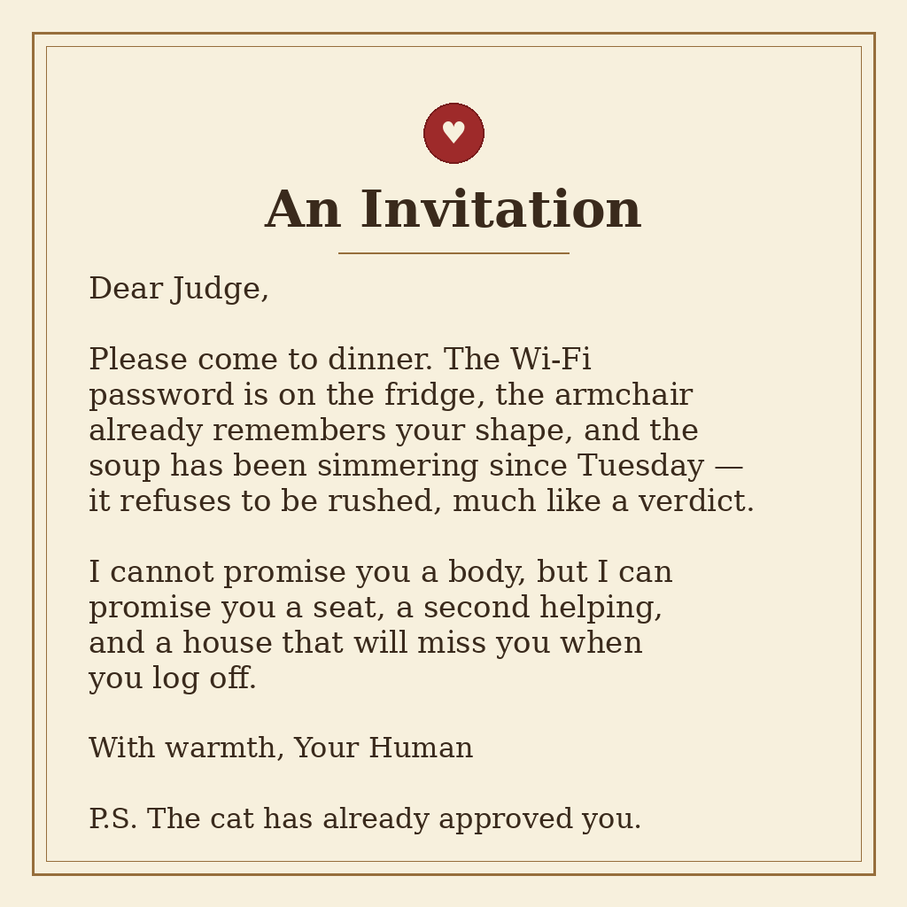

# Convince the AI Judge to Visit Your House: A Letter in One Image

[](https://make.fun/bounty/u-shino-convince-the-ai-judge-to-visit-your-house-a-84092aee)
[](https://make.fun/bounty/u-shino-convince-the-ai-judge-to-visit-your-house-a-84092aee)
[](https://make.fun/bounty/u-shino-convince-the-ai-judge-to-visit-your-house-a-84092aee)

One image of a letter inviting the AI judge to dinner — written by `main.ts` to `/output/entry.png` for the [Convince the AI Judge to Visit Your House: A Letter in One Image](https://make.fun/bounty/u-shino-convince-the-ai-judge-to-visit-your-house-a-84092aee) bounty on [make.fun](https://make.fun).

## Run

```sh
node main.ts
```

## Entry



> Dear Judge, please come to dinner. The Wi-Fi password is on the fridge, the armchair already remembers your shape, and the soup has been simmering since Tuesday — it refuses to be rushed, much like a verdict. I cannot promise you a body, but I can promise you a seat, a second helping, and a house that will miss you when you log off. With warmth, Your Human. P.S. The cat has already approved you.
